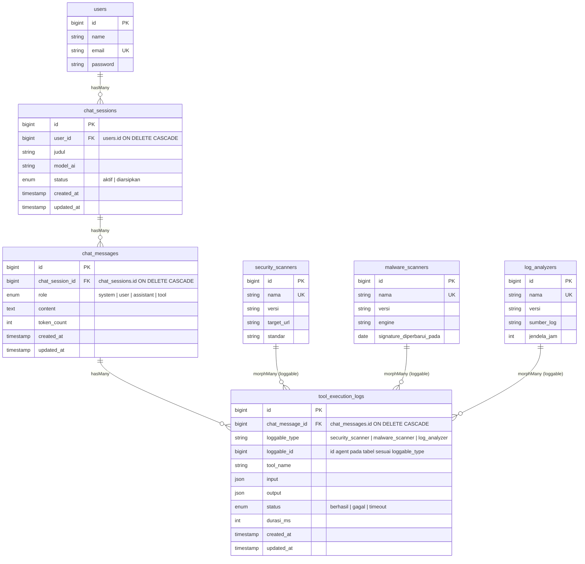
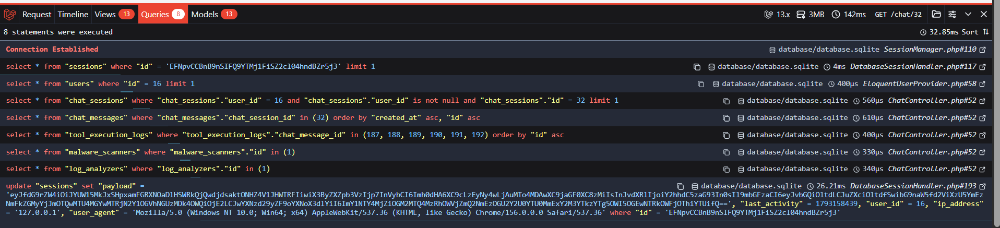

# Portal Akademik: Dashboard & RBAC

Tugas mandiri PBKK Pertemuan 10: lanjutan proyek *Secure Academic Portal* (Laravel 13 + Breeze) yang kini punya panel backoffice **AdminLTE** dan otorisasi dinamis **Spatie Laravel Permission** dengan dua peran: **Admin** (akses penuh) dan **Staf** (akses terbatas).

**Pradhipta Raja Mahendra** · NRP 5025241055 · Teknik Informatika · Institut Teknologi Sepuluh Nopember (ITS)

## Akun

Semua password: `password`. Saat `DEMO_LOGIN_ENABLED=true`, halaman login juga menampilkan tombol **Masuk sebagai Admin / Staf / Mahasiswa** sehingga tidak perlu mengetik apa pun.

| Peran | Email | Setelah login |
|---|---|---|
| **Admin** (dosen penguji) | `dosenpbkk@its.ac.id` | `/admin`: akses penuh, termasuk hapus data dan pengaturan peran |
| **Staf** (staf akademik) | `staf@its.ac.id` | `/admin`: lihat data, tambah dan ubah proposal, **tanpa** hapus |
| Mahasiswa (tanpa peran) | `5025241055@student.its.ac.id` | `/dashboard`: membuka `/admin` menghasilkan **403** |
| 29 mahasiswa acak | `NRP@student.its.ac.id` (lihat menu Mahasiswa) | `/dashboard` |

## Menjalankan Project

Prasyarat: PHP 8.3+, Composer, Node.js, MySQL/MariaDB (XAMPP).

1. Buat database kosong (di XAMPP, port MySQL default proyek ini 3307):

   ```sql
   CREATE DATABASE portal_akademik_rbac CHARACTER SET utf8mb4 COLLATE utf8mb4_unicode_ci;
   ```

2. Salin `.env.example` ke `.env`, lalu sesuaikan `DB_PORT`, `DB_USERNAME`, dan `DB_PASSWORD`.
3. Jalankan instalasi sekali jalan. Perintah ini memasang dependensi, membuat `APP_KEY`, **menjalankan migrasi sekaligus seeder Faker otomatis**, lalu mem-build aset:

   ```bash
   composer setup
   php artisan serve
   ```

Buka http://127.0.0.1:8000/login lalu klik salah satu tombol login instan.

Untuk mengulang data dari awal: `php artisan migrate:fresh --seed`.

Tanpa MySQL, project juga bisa dijalankan dengan SQLite: ubah `DB_CONNECTION=sqlite` di `.env`, beri tanda `#` pada baris `DB_HOST` sampai `DB_PASSWORD`, lalu buat berkas `database/database.sqlite` yang kosong.

## Pertemuan 10: Dashboard & RBAC

### Pemetaan Spesifikasi Wajib

| No | Aturan | Implementasi |
|---|---|---|
| 1 | UI backoffice AdminLTE | Paket `jeroennoten/laravel-adminlte` v4 (Bootstrap 5). Setiap halaman panel memakai `@extends('adminlte::page')`: `resources/views/admin/**`. Menu sidebar diatur di `config/adminlte.php`. |
| 2 | Autentikasi Breeze terverifikasi | Model `User` mengimplementasikan `MustVerifyEmail`. Grup route `/admin` memakai middleware `auth` + `verified`, sehingga akun yang emailnya belum diverifikasi diarahkan ke halaman verifikasi. |
| 3 | Otorisasi tersimpan di database (Spatie) | Tabel `roles`, `permissions`, `model_has_roles`, `role_has_permissions`, dan `model_has_permissions` dari migrasi Spatie. Isinya dibuat `RolePermissionSeeder`. Admin bisa mengganti peran user lewat menu **Peran Pengguna**, dan perubahannya langsung tersimpan ke tabel tersebut. |
| 4 | Minimal 3 widget statistik | Beranda `/admin` menampilkan 4 *small box* AdminLTE: Mahasiswa, Proposal, Riwayat Tugas, dan Sesi Obrolan AI. Semuanya dihitung dengan `Model::count()` di `Admin\DashboardController`. |
| 5 | Pengaman controller `permission:` | Setiap controller admin mengimplementasikan `HasMiddleware` dengan `new Middleware('permission:...', only: [...])`. Ini cara resmi Laravel 11+ sebagai pengganti `$this->middleware()` di constructor. |

### Matriks Peran

| Permission | Admin | Staf | Dipakai di |
|---|:-:|:-:|---|
| `dashboard.lihat` | ✓ | ✓ | Beranda `/admin` |
| `proposal.lihat` | ✓ | ✓ | Tabel proposal |
| `proposal.tambah` | ✓ | ✓ | Tambah proposal |
| `proposal.ubah` | ✓ | ✓ | Ubah proposal |
| `mahasiswa.lihat` | ✓ | ✓ | Tabel mahasiswa |
| `tugas.lihat` | ✓ | ✓ | Tabel riwayat tugas |
| `data.hapus` | ✓ | | Hapus proposal, mahasiswa, dan tugas |
| `pengguna.kelola` | ✓ | | Menu Peran Pengguna |

Admin mendapat seluruh permission secara eksplisit, tanpa `Gate::before`, sehingga setiap pengecekan tetap membaca tabel otorisasi.

### Tiga Lapis Pengaman

1. **Route** (`routes/web.php`): grup `/admin` memakai `['auth', 'verified', 'role:Admin|Staf']`. User tanpa peran langsung mendapat 403.
2. **Controller**: permission dicek per aksi lewat `HasMiddleware`. Contoh di `ProposalController`:

   ```php
   public static function middleware(): array
   {
       return [
           new Middleware('permission:proposal.lihat', only: ['index']),
           new Middleware('permission:proposal.tambah', only: ['create', 'store']),
           new Middleware('permission:proposal.ubah', only: ['edit', 'update']),
           new Middleware(['role:Admin', 'permission:data.hapus'], only: ['destroy']),
       ];
   }
   ```

3. **Blade**: menu sidebar memakai kunci `'can' => 'permission'`, sehingga menu tanpa izin tidak dirender. Tombol aksi dibungkus `@can`.

### Hak Eksklusif "Hapus Data"

Tombol hapus ada di komponen `resources/views/components/admin/tombol-hapus.blade.php` dan **hanya dirender** bila user berperan Admin *dan* memegang `data.hapus` (`@role('Admin')` + `@can('data.hapus')`). Aksi `destroy` di controller dijaga aturan yang sama (`role:Admin` + `permission:data.hapus`):

- Staf tidak melihat tombol hapus. Bila Staf menembak `DELETE /admin/proposal/5` langsung, hasilnya **403** dan data tetap ada.
- Seandainya `data.hapus` diberikan langsung ke akun Staf, hapus tetap ditolak karena syarat peran Admin murni tidak terpenuhi (diuji di `AdminPanelTest`).

### Challenge

| Challenge | Implementasi |
|---|---|
| Filter pencarian `when()` | Tabel Proposal (kata kunci + tema agent), Mahasiswa (kata kunci + program studi), Riwayat Tugas (kata kunci + mata kuliah + status nilai), dan Peran Pengguna (kata kunci + peran). Setiap filter ditambahkan lewat `->when($nilai, fn ($q, $nilai) => ...)`, sehingga `WHERE` hanya muncul bila parameternya diisi. Parameter divalidasi lebih dulu. |
| Pengunci pagination | `->paginate(10)->withQueryString()`. Link halaman 2 dari `?cari=Agen&tema=Ollama` menjadi `?cari=Agen&tema=Ollama&page=2`, sehingga filter tidak hilang. |
| Auto-seeder Faker realistis | `composer setup` menjalankan `migrate --seed`. `DatabaseSeeder` membuat peran dan permission, **30 mahasiswa**, **63 proposal**, **92 riwayat tugas**, dan **64 sesi obrolan** berisi 384 pesan serta 208 log tool. Data dibuat dengan Faker `id_ID`: nama Indonesia, NRP sesuai kode prodi, dan judul proposal yang dirangkai dari domain dan tujuan nyata. |
| Auto-login test accounts | Tombol **Masuk sebagai …** di halaman login (`DemoLoginController`). Pengamannya: hanya aktif bila `DEMO_LOGIN_ENABLED=true` **dan** environment bukan production. Akun dipilih dari whitelist `config/demo.php` (bukan email dari request), tetap memakai POST + CSRF, diberi throttle, dan session diregenerasi. |

## Skema Database

| Tabel | Kolom penting | Catatan |
|---|---|---|
| `users` | `name`, `email` (**unique**), `password`, `nrp` (unique, nullable), `program_studi`, `bio`, `minat` (JSON), `keahlian` (JSON) | Tabel bawaan Breeze, ditambah kolom profil diri lewat migration terpisah. |
| `projects` | `user_id`, `judul`, `deskripsi` (**nullable**), `tahapan` (JSON), `tema_agent` (**default `Ollama`**), `api_key_secure` | Proposal ide proyek Agentic AI. |
| `assignments` | `user_id`, `mata_kuliah`, `judul`, `deskripsi`, `tautan`, `nilai`, `dikumpulkan_pada` | Riwayat tugas kuliah. |

- `user_id` di `projects` dan `assignments` memakai `foreignId()->constrained('users')->cascadeOnDelete()`. Menghapus user ikut menghapus data miliknya.
- `api_key_secure` bertipe `TEXT`, bukan `VARCHAR(255)`, karena disimpan terenkripsi. Payload enkripsi untuk key 36 karakter sudah sepanjang 256 karakter.
- Alasan pemilihan tipe setiap kolom ditulis sebagai komentar di file migration.

## Pertemuan 9: Pemodelan Relasi Agentic AI Platform

Fondasi basis data untuk mencatat sesi obrolan dengan agent AI, isi pesannya, dan log pemanggilan tool (*tool calling*) oleh agent. Halaman **Obrolan AI** (`/chat`) menampilkan riwayat obrolan milik user yang login.

### Entity-Relationship Diagram



### Relasi Model

| Model | Method | Relasi |
|---|---|---|
| `User` | `chatSessions()` | `hasMany(ChatSession)` |
| `ChatSession` | `user()` / `messages()` | `belongsTo(User)` / `hasMany(ChatMessage)` |
| `ChatMessage` | `chatSession()` / `toolExecutionLogs()` | `belongsTo(ChatSession)` / `hasMany(ToolExecutionLog)` |
| `ToolExecutionLog` | `chatMessage()` / `loggable()` | `belongsTo(ChatMessage)` / `morphTo()` |
| `SecurityScanner`, `MalwareScanner`, `LogAnalyzer` | `toolExecutionLogs()` | `morphMany(ToolExecutionLog, 'loggable')` lewat trait `HasToolExecutionLogs` |

`ChatSession::toolExecutionLogs()` (`hasManyThrough`) juga tersedia untuk menghitung jumlah pemanggilan tool per sesi.

### Migrasi dan Integritas Data

- Setiap foreign key memakai `foreignId(...)->constrained(...)->onDelete('cascade')`: menghapus user ikut menghapus sesi, pesan, dan log tool miliknya.
- Kolom `user_id`, `chat_session_id`, dan `chat_message_id` sengaja tidak masuk `$fillable`. Data anak selalu dibuat lewat relasi, misalnya `$user->chatSessions()->create([...])`.
- Index gabungan `(user_id, updated_at)` dan `(chat_session_id, created_at)` mendukung pola query daftar riwayat dan urutan pesan.

### Challenge 1: Polymorphic Logging

- Migrasi `tool_execution_logs` memakai `$table->morphs('loggable')`, yang membuat kolom `loggable_type`, `loggable_id`, dan index gabungannya.
- Satu tabel log dipakai bersama oleh tiga jenis agent khusus: `SecurityScanner`, `MalwareScanner`, dan `LogAnalyzer`. Menambah jenis agent baru cukup dengan membuat model yang memakai trait `HasToolExecutionLogs` tanpa mengubah tabel log.
- `Relation::enforceMorphMap()` di `AppServiceProvider` menyimpan alias pendek (`security_scanner`) alih-alih nama class lengkap, sehingga data tetap valid bila namespace model berubah.
- Kolom polymorphic tidak bisa diberi foreign key constraint. Sebagai gantinya, trait `HasToolExecutionLogs` menghapus log milik agent saat agent tersebut dihapus.

### Challenge 2: Optimasi Kueri Riwayat Obrolan

`ChatController@show` memuat satu sesi beserta seluruh pesan, seluruh log tool, dan agent pemanggilnya dengan eager loading bertingkat:

```php
$session = $request->user()
    ->chatSessions()
    ->with([
        'messages' => fn (HasMany $query) => $query->oldest()->oldest('id'),
        'messages.toolExecutionLogs' => fn (HasMany $query) => $query->oldest('id'),
        'messages.toolExecutionLogs.loggable',
    ])
    ->findOrFail($chatSession);
```

Query yang dijalankan selalu berjumlah tetap, berapa pun banyaknya pesan dan log:

```sql
select * from chat_sessions where user_id = ? and id = ? limit 1
select * from chat_messages where chat_session_id in (?) order by created_at, id
select * from tool_execution_logs where chat_message_id in (?, ?, ?, ...) order by id
select * from security_scanners where id in (?)   -- satu query per jenis agent yang muncul
select * from log_analyzers where id in (?)
```

`ChatController@index` memakai `withCount(['messages', 'toolExecutionLogs'])` sehingga jumlah pesan dan log per sesi dihitung lewat subquery, bukan query terpisah per baris.

Bukti bebas N+1:

1. **`Model::preventLazyLoading()`** aktif di luar production. Lazy loading di view langsung melempar exception, sehingga N+1 tidak bisa lolos diam-diam.
2. **`ChatTest::test_chat_detail_query_count_does_not_grow_with_messages`** membandingkan sesi berisi 6 pesan dengan sesi berisi 26 pesan dan 60+ log. Jumlah query keduanya harus sama.
3. **Laravel Debugbar** (`fruitcake/laravel-debugbar`, dev dependency) aktif otomatis bila `APP_DEBUG=true`. Buka `/chat`, pilih salah satu sesi, lalu buka tab **Queries** di Debugbar untuk melihat daftar query di atas. Debugbar juga menampilkan query `sessions` dan `users` dari middleware autentikasi, sehingga totalnya 8 query, bukan 1 + N.

<!-- Ganti dengan screenshot tab Queries Laravel Debugbar pada halaman /chat/{id} -->


### Data Dummy

`ChatSeeder` (dipanggil terakhir oleh `DatabaseSeeder`) membuat 3 agent (WebSentinel, FileGuard, LogLens), lalu memberi setiap user 2 sesi obrolan dari 4 skenario keamanan yang koheren: pertanyaan user, jawaban agent, dan log tool yang benar-benar dipakai untuk menjawab. Setelah `migrate:fresh --seed` hasilnya **64 sesi, 384 pesan, dan 208 log tool** yang tersebar ke ketiga jenis agent. Seeder aman dijalankan berulang karena user yang sudah punya sesi dilewati.

Factory yang dipakai: `ChatSessionFactory` (state `withConversation()`), `ChatMessageFactory` (state `fromUser()` dan `fromAssistant()`), `ToolExecutionLogFactory` (nama tool, input, dan output menyesuaikan jenis agent), serta `SecurityScannerFactory`, `MalwareScannerFactory`, dan `LogAnalyzerFactory`.

## Dari Data Statis ke Database

Di Tugas 4, profil, skill, dan tahapan pipeline AutoQA Agent ditulis sebagai array di `PageController`. Sekarang semuanya dibaca dari database:

| Halaman | Sumber data |
|---|---|
| `/` Portal kampus (umum) | Statistik agregat, sebaran mahasiswa per program studi, dan proposal terbaru seluruh mahasiswa, tanpa email, NRP, maupun API key |
| `/portofolio` Beranda portofolio | Nama, bio, jumlah proposal, dan jumlah tugas pemilik portofolio |
| `/profil-mahasiswa` | Kolom profil di `users` + riwayat tugas dari `assignments` |
| `/ide-agent` | Proposal unggulan (punya `tahapan`) dan proposal lain dari `projects`. Formulir ide menyimpan ke `projects` milik user yang login. |
| `/dashboard` | Data milik user yang sedang login |
| `/chat`, `/chat/{id}` | Sesi obrolan Agentic AI milik user yang login, beserta pesan dan log tool |

Akun pemilik portofolio diatur lewat `PORTFOLIO_OWNER_EMAIL` (default di `config/portfolio.php`).

## Keamanan

- **Mass assignment:** model `Project` dan `Assignment` mendefinisikan `$fillable` secara eksplisit **tanpa `user_id`**. Kepemilikan diisi lewat relasi, misalnya `$user->projects()->create([...])`, sehingga request tidak bisa menyisipkan `user_id` milik orang lain.
- **Enkripsi:** `api_key_secure` memakai cast `encrypted` (dienkripsi dengan `APP_KEY`) dan masuk `$hidden`, sehingga tidak ikut saat model diubah ke JSON. Di dashboard hanya tampil ter-mask, misalnya `sk-****0a6e`.
- **Query dashboard:** `$request->user()->projects()->latest()->get()` hanya mengambil data milik user yang login, diurutkan dari yang terbaru. Eloquent memakai prepared statement, tanpa raw query.
- **Route:** `/dashboard`, `/chat`, dan `POST /ide-agent` dilindungi middleware `auth` dan `verified`.
- **Formulir ide:** divalidasi `StoreProjectRequest` (`tema_agent` harus salah satu pilihan), lalu disimpan lewat `$request->user()->projects()->create($request->validated())`. `user_id` yang disisipkan ke request diabaikan.
- **XSS:** semua output Blade memakai `{{ }}`. Tautan tugas hanya dirender bila diawali `https://`.
- **`.env`:** tercantum di `.gitignore` dan tidak di-commit.

## Factory dan Seeder

- `UserFactory`: nama Indonesia (`id_ID`), NRP sesuai kode prodi (5024–5027), email unik `NRP@student.its.ac.id`, serta bio, minat, dan keahlian acak.
- `ProjectFactory`: judul dan deskripsi dirangkai dari 8 domain (pendidikan, kesehatan, logistik, keuangan, pertanian, layanan publik, software testing, keamanan siber) dengan tujuan konkret per domain, 4 jenis agen, dan 6 provider (Ollama, OpenAI, Claude, Gemini, LangChain, CrewAI). API key berupa string acak dummy.
- `AssignmentFactory`: tugas realistis dari beberapa mata kuliah Informatika.
- `DatabaseSeeder` memanggil:
  - `RolePermissionSeeder`: 8 permission dan peran Admin/Staf (`findOrCreate` + `syncPermissions`).
  - `PortfolioOwnerSeeder`: akun pemilik portofolio via `updateOrCreate`.
  - `StudentSeeder`: mahasiswa acak hingga total 30 mahasiswa (pemilik + 29 acak), masing-masing tepat 2 project dan 3 riwayat tugas.
  - `DemoUserSeeder`: akun dosen demo (peran Admin) dan akun staf (peran Staf) via `updateOrCreate`.
  - `ChatSeeder`: 3 agent keamanan dan 2 sesi obrolan per user (lihat bagian Pertemuan 9).

`php artisan db:seed` aman dijalankan berulang kali. `StudentSeeder` hanya membuat kekurangan dari 30 mahasiswa, sedangkan akun pemilik dan akun demo di-upsert. Setelah `migrate:fresh --seed`, hasilnya selalu **32 user (30 mahasiswa + dosen + staf), 63 project (30×2 + 3), 92 riwayat tugas (29×3 + 5)**.

## Pengujian

```bash
php artisan test          # Breeze + DashboardTest (isolasi data, cascade) + PortalTest (portal umum tanpa data sensitif) + PortfolioTest (halaman publik dari DB, formulir aman) + ChatTest (relasi, polymorphic, cascade, bebas N+1) + AdminPanelTest (RBAC, hapus khusus Admin, widget, when(), withQueryString()) + DemoLoginTest
./vendor/bin/pint --test  # PSR-12
```

## Struktur File Utama

```
app/Http/Controllers/{Chat,Dashboard,Page,Portal}Controller.php
app/Http/Controllers/Admin/{Dashboard,Proposal,Mahasiswa,Tugas,Pengguna}Controller.php
app/Http/Controllers/Auth/DemoLoginController.php
app/Http/Requests/Admin/ProposalRequest.php
config/{adminlte,permission,demo}.php
database/seeders/RolePermissionSeeder.php
resources/views/admin/**  (dashboard, proposal, mahasiswa, tugas, pengguna)
resources/views/components/admin/tombol-hapus.blade.php
tests/Feature/{AdminPanel,DemoLogin}Test.php
app/Http/Requests/StoreProjectRequest.php
config/portfolio.php
app/Models/{User,Project,Assignment}.php
app/Models/{ChatSession,ChatMessage,ToolExecutionLog}.php
app/Models/{SecurityScanner,MalwareScanner,LogAnalyzer}.php
app/Models/Concerns/HasToolExecutionLogs.php
database/migrations/*_create_projects_table.php
database/migrations/*_create_assignments_table.php
database/migrations/*_add_profile_columns_to_users_table.php
database/migrations/*_add_tahapan_to_projects_table.php
database/migrations/*_create_{chat_sessions,chat_messages,tool_execution_logs}_table.php
database/migrations/*_create_{security_scanners,malware_scanners,log_analyzers}_table.php
database/factories/{User,Project,Assignment,ChatSession,ChatMessage,ToolExecutionLog}Factory.php
database/factories/{SecurityScanner,MalwareScanner,LogAnalyzer}Factory.php
database/seeders/{Database,PortfolioOwner,Student,DemoUser,Chat}Seeder.php
resources/views/{portal,dashboard}.blade.php
resources/views/pages/{beranda,profil,ide-agent}.blade.php
resources/views/chat/{index,show}.blade.php
tests/Feature/{Chat,Dashboard,Portal,Portfolio}Test.php
```

Halaman portofolio publik memakai layout `resources/views/layouts/portfolio.blade.php`; halaman yang butuh login memakai layout Breeze.
